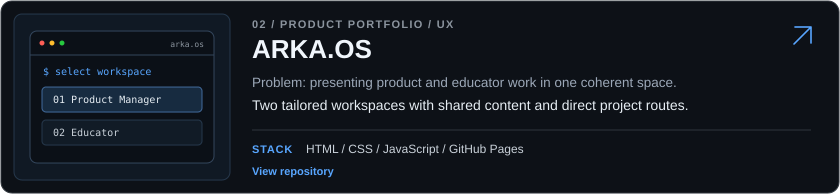

<div align="center">


[Portfolio](https://arkadeeptaroy.github.io/portfolio/) &nbsp; / &nbsp; [Repositories](https://github.com/arkadeeptaroy?tab=repositories) &nbsp; / &nbsp; [Writing](https://whenthemadmanwrites.wordpress.com/)

</div>

### `~/projects`

<div align="center">
<a href="https://github.com/arkadeeptaroy/ChapterGrade"></a>
<a href="https://github.com/arkadeeptaroy/portfolio"></a>
</div>

### `~/workspace`

```text
Product       Discovery / Roadmaps / Execution
Education     Curriculum / Pedagogy / Assessment
Building      JavaScript / HTML / CSS / Node.js
```

### `~/activity`

<div align="center">


<a href="https://github.com/arkadeeptaroy?tab=overview"></a>

</div>
