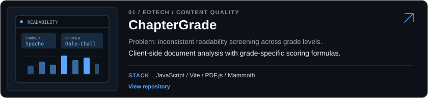

[Portfolio](https://arkadeeptaroy.github.io/portfolio/) &nbsp; / &nbsp; [Repositories](https://github.com/arkadeeptaroy?tab=repositories) &nbsp; / &nbsp; [Writing](https://whenthemadmanwrites.wordpress.com/)

I work at the intersection of product management, education and technology. My focus is on defining product requirements, designing practical workflows and building tools that solve operational and learning problems.

### Selected work

[View portfolio](https://arkadeeptaroy.github.io/portfolio/) &nbsp; / &nbsp; [All public repositories](https://github.com/arkadeeptaroy?tab=repositories)

### Product practice

| Discovery &amp; strategy | Execution &amp; delivery | Quality &amp; measurement |
| :--- | :--- | :--- |
| Problem framing, requirements, prioritisation | Roadmaps, milestones, cross-functional coordination | Acceptance criteria, quality frameworks, progress reporting |

### Toolbox

### Contribution activity

