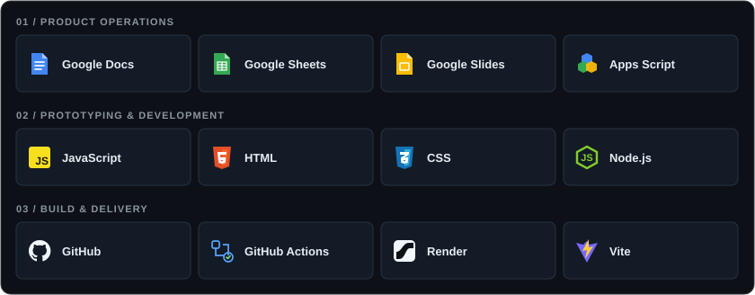

[Portfolio](https://arkadeeptaroy.github.io/portfolio/) &nbsp; / &nbsp; [Repositories](https://github.com/arkadeeptaroy?tab=repositories)

### Selected work

| Project | Technical overview |
| :--- | :--- |
| [ChapterGrade](https://github.com/arkadeeptaroy/ChapterGrade) | Client-side readability screening for PDF, DOCX and text using Spache and Dale–Chall, with word-count analysis. |
| [PDF Core](https://pdf-compressor-web-8xz1.onrender.com/) · Live app | Browser-based PDF compression, merging and PNG conversion with a separate Python processing API. |
| [ARKA.OS](https://github.com/arkadeeptaroy/portfolio) | Dual-workspace portfolio built in HTML, CSS and JavaScript, with hash routing and Playwright tests. |

#### Web experiments

| Project | Technical overview |
| :--- | :--- |
| [Do You Love Me?](https://github.com/arkadeeptaroy/mini_app_1) | Interactive single-page experiment with evasive button behaviour, pointer/touch events and CSS animations. |
| [The Petty Voodoo Ritual](https://github.com/arkadeeptaroy/mini_app_2) | Interactive image hotspots, state-driven UI controls and particle animations in vanilla JavaScript. |

### Toolbox

### Contribution activity

