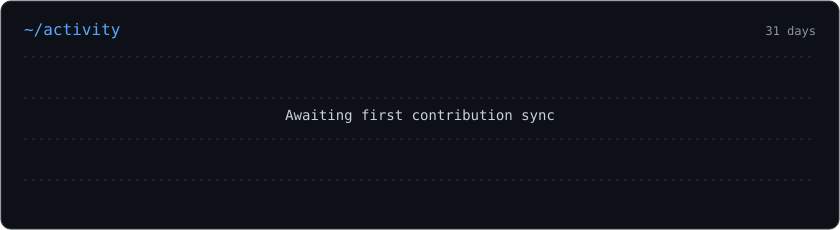

[Portfolio](https://arkadeeptaroy.github.io/portfolio/) &nbsp; / &nbsp; [Repositories](https://github.com/arkadeeptaroy?tab=repositories) &nbsp; / &nbsp; [Writing](https://whenthemadmanwrites.wordpress.com/)

Product Manager working across education, AI-enabled workflows and SaaS.

### Selected work

| Product / project | Technical overview |
| :--- | :--- |
| [Catalyst Publishing](https://arkadeeptaroy.github.io/portfolio/#/projects/03) | Grades 1–5 curriculum, textbooks, workbooks and assessment production aligned to NEP/NCF. |
| [ChapterGrade](https://github.com/arkadeeptaroy/ChapterGrade) | Client-side PDF/DOCX readability and word-count analysis using Spache and Dale–Chall. |
| [PDF Core](https://pdf-compressor-web-8xz1.onrender.com/) | PDF compression, document merging and PDF/PNG conversion. |
| [LearnDex](https://arkadeeptaroy.github.io/portfolio/#/projects/02) | AI-assisted lesson planning based on individual learner profiles and instructional sequencing. |
| [Synapse/lab](https://arkadeeptaroy.github.io/portfolio/#/projects/01) | Inclusive learning product grounded in Cognitive Load Theory and Universal Design for Learning. |
| [AI Content Governance](https://arkadeeptaroy.github.io/portfolio/#/projects/05) | Structured LLM evaluation, schema validation, assessment alignment and human release gates. |
| [Assessment Engine](https://arkadeeptaroy.github.io/portfolio/#/projects/07) | Bloom’s and RUAH-aligned assessment generation with JSON-schema and difficulty checks. |
| [ContentOps Suite](https://arkadeeptaroy.github.io/portfolio/#/projects/08) | CSV-driven content automation, reusable prompt pipelines and human review checkpoints. |
| [Tri-Axis Curriculum Bot](https://arkadeeptaroy.github.io/portfolio/#/projects/04) | Curriculum topic evaluation against three learning frameworks and inclusion criteria. |
| [SRT Tool](https://arkadeeptaroy.github.io/portfolio/#/projects/06) | Python/Whisper subtitle generation and QA for English, Hindi and Bengali. |
| [ARKA.OS](https://github.com/arkadeeptaroy/portfolio) | Terminal-based portfolio with two workspaces, shared content and hash-based routing. |

### Product practice

| Discovery &amp; strategy | Execution &amp; delivery | Quality &amp; measurement |
| :--- | :--- | :--- |
| Problem framing, requirements, prioritisation | Roadmaps, milestones, cross-functional coordination | Acceptance criteria, quality frameworks, progress reporting |

### Toolbox

### Contribution activity

