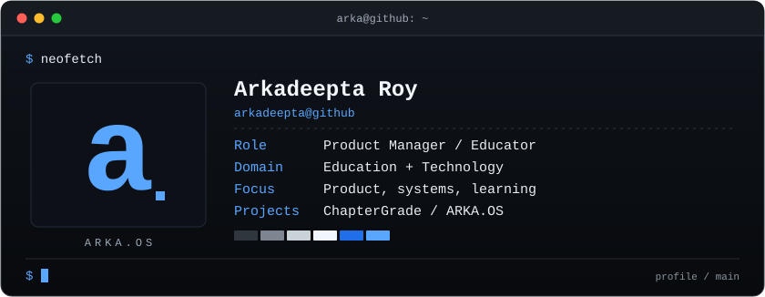

[Portfolio](https://arkadeeptaroy.github.io/portfolio/) &nbsp; / &nbsp; [Repositories](https://github.com/arkadeeptaroy?tab=repositories)

### Selected work

| Project | Technical overview |
| :--- | :--- |
| [ChapterGrade](https://github.com/arkadeeptaroy/ChapterGrade) | Client-side PDF, DOCX and text readability screening using Spache and Dale–Chall, with word-count analysis. |
| [PDF Core / PDF Compressor](https://pdf-compressor-web-8xz1.onrender.com/) | Browser-based PDF compression, merging and PNG conversion, with a separate Python processing API. |
| [ARKA.OS](https://github.com/arkadeeptaroy/portfolio) | Dual-workspace web portfolio with terminal UI, hash routing and Playwright tests. |
| FinLog | Mobile-first personal finance logger built with React and Vite, using localStorage persistence. |
| Grub | Food logging and spending analytics with React, Tailwind CSS, Zustand and Supabase authentication and data storage. |
| RecallBox | React-based content capture and retrieval app for categorising and searching links, notes and references. |

FinLog, Grub and RecallBox have private source repositories. PDF Core is the live deployment of the private PDF compressor repository.

### Toolbox

### Contribution activity

